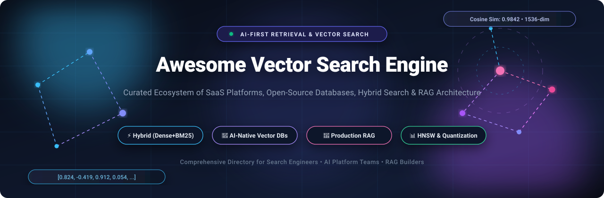

<p align="center">
  
</p>

<p align="center">
  <a href="https://github.com/ishandutta2007/Awesome-Awesome-Awesome"></a><a href="https://discord.gg/jc4xtF58Ve"></a>
  <a href="https://github.com/ishandutta2007/Awesome-Vector-Search-Engine/stargazers"></a>
  <a href="https://github.com/ishandutta2007/Awesome-Vector-Search-Engine/network/members"></a>
  <a href="https://github.com/ishandutta2007/Awesome-Vector-Search-Engine/issues"></a>
  <a href="https://github.com/ishandutta2007/Awesome-Vector-Search-Engine/blob/main/LICENSE"></a>
  <a href="https://github.com/ishandutta2007/Awesome-Vector-Search-Engine/pulls"></a>
  <a href="https://github.com/ishandutta2007"></a>
</p>

---

# 🚀 Awesome Vector Search Engine & AI Retrieval Ecosystem

> **The Definitive, Curated Directory of SaaS Platforms & Open-Source Vector Search Engines, High-Dimensional Databases, Approximate Nearest Neighbor (ANN) Libraries, and Hybrid Retrieval Systems for Generative AI & Enterprise RAG.**

Welcome to the ultimate directory for **Vector Search Engines**, **Vector Databases (Vector DB)**, and **Hybrid Retrieval Systems**. In modern Generative AI, Retrieval-Augmented Generation (RAG), e-commerce discovery, and enterprise knowledge retrieval, vector search serves as the memory and semantic indexing backbone. This guide benchmarks SaaS hosted solutions against open-source implementations to help architects and search engineers select the ideal retrieval engine.

---

## 📑 Table of Contents

- [🌐 Sector Overview & Market Dynamics](#-sector-overview--market-dynamics)
- [☁️ SaaS & Managed Hosted Search Platforms](#️-saas--managed-hosted-search-platforms)
  - [SaaS Comparison Matrix](#saas-comparison-matrix)
- [💻 Open-Source Vector Search Projects](#-open-source-vector-search-projects)
  - [Ranked Open-Source Directory (Sorted by Stars)](#ranked-open-source-directory-sorted-by-stars)
  - [Open-Source Architectural Matrix](#open-source-architectural-matrix)
- [🧠 Architectural Taxonomy: Dense vs. Sparse vs. Hybrid](#-architectural-taxonomy-dense-vs-sparse-vs-hybrid)
- [🎯 Choosing the Right Engine: Decision Guide](#-choosing-the-right-engine-decision-guide)
- [📖 Glossary & Core Concepts](#-glossary--core-concepts)
- [🤝 How to Contribute](#-how-to-contribute)
- [⭐ Star History](#-star-history)
- [💖 Support & Sponsorship](#-support--sponsorship)
- [📜 License & Disclaimer](#-license--disclaimer)

---

## 🌐 Sector Overview & Market Dynamics

The global **Vector Database & Vector Search Engine** market was valued at **$1.8 Billion in 2024** and is projected to surge past **$10.5 Billion by 2030**, reflecting a blistering **CAGR of ~31.2%**, propelled by the universal adoption of Retrieval-Augmented Generation (RAG), conversational LLM assistants, and multimodal AI.

Rather than consolidating into a monolithic winner-take-all ecosystem, the sector remains **moderately fragmented** and segmented into three distinct architectural battlegrounds:

1. **Cloud Hyperscalers (Microsoft, Google Cloud, AWS):** Dominating incumbent enterprise accounts by packaging vector search with existing cloud data warehouses, identity management, and foundational model endpoints.
2. **AI-Native Pure-Play Vector Databases (Pinecone, Milvus/Zilliz, Weaviate, Qdrant, Chroma):** Leading developer mindshare, RAG tooling ecosystems, and index innovations (HNSW, DiskANN, multi-stage scalar filtering, binary quantization).
3. **Enterprise & Lexical Search Incumbents (Elastic, Algolia, Coveo, OpenSearch, Vespa):** Capitalizing on decades of relevance engineering, typo-tolerance, and facet analytics by blending dense embeddings with inverted keyword indexes in hybrid reciprocal rank fusion (RRF) pipelines.

---

## ☁️ SaaS & Managed Hosted Search Platforms

The table below compiles leading **SaaS and managed cloud vector search platforms**, sorted in **descending order by company size** (Market Capitalization, Private Valuation, or Annual Recurring Revenue).

### SaaS Comparison Matrix

| # | 🏢 Platform / Service | 💰 Company Size (Valuation / Market Cap) | 🏷️ Starting Pricing (Specific Entry Tier) | 🎁 Free Tier Limit (Forever or Trial Limits) | ⚡ Key Specialization & Capabilities |
|---|----------------------|-----------------------------------------|------------------------------------------|---------------------------------------------|--------------------------------------|
| **1** | [**Microsoft Azure AI Search**](https://azure.microsoft.com/en-us/products/ai-services/ai-search) | **~$3.1 Trillion** (Market Cap) | **$73.00/month** ($0.10/hour for Basic Tier) | **Free Forever Tier (F):** 3 indexes, 50 MB storage, 10,000 hosted documents, 1 indexer | Enterprise cloud search featuring integrated semantic reranking, BM25 + dense vector hybrid search, and native Azure OpenAI integrations. |
| **2** | [**Google Cloud Vertex AI Search**](https://cloud.google.com/enterprise-search) | **~$2.1 Trillion** (Alphabet Market Cap) | **$5.00 per 1,000 search queries** (Enterprise search; Generative answering at $1.00/1k) | **Free Trial:** $300 free credits for 90 days across GCP; includes free tier of 1,000 search queries/day | Google-grade semantic and conversational search with multimodal retrieval, document grounding, and turnkey connector ecosystem. |
| **3** | [**Amazon Kendra**](https://aws.amazon.com/kendra/) | **~$2.0 Trillion** (Amazon Market Cap) | **$810.00/month** ($1.125/hour for Developer Edition; $1,400/mo for Enterprise) | **Free Trial:** 30-Day Free Tier (up to 750 hours of Developer Edition, max 10k documents & 1,250 queries/day) | Intelligent ML-driven enterprise search service with 40+ pre-built enterprise connectors (SharePoint, Confluence, S3) and semantic FAQ answering. |
| **4** | [**Elastic Cloud (Enterprise Search)**](https://www.elastic.co/cloud) | **~$9.2 Billion** (Elastic N.V. Market Cap) | **$95.00/month** ($0.13/hour on Standard Tier deployment) | **Free Trial:** 14-Day Free Trial (up to 2 active deployments, 8 GB RAM, 240 GB storage, no credit card required) | Managed Elasticsearch featuring dense vector indexing (HNSW), ELSER learned sparse retrieval, lexical search, and hybrid Reciprocal Rank Fusion (RRF). |
| **5** | [**Algolia NeuralSearch**](https://www.algolia.com/) | **~$2.25 Billion** (Series D Valuation) | **$0.50 per 1,000 search requests** (Grow Plan pay-as-you-go above free tier; Premium at $1.50/1k) | **Free Forever (Build Plan):** 10,000 search requests/month and 10,000 indexed records with full API access | Sub-millisecond instant-as-you-type search combining neural semantic understanding with lightning-fast keyword matching and merchandising UI components. |
| **6** | [**Pinecone**](https://www.pinecone.io/) | **~$750 Million** (Series B Valuation) | **$20.00/month** (Builder Plan) or **$0.33 per million read units** + $0.08/GB storage on Serverless | **Free Forever (Starter Plan):** 2 GB index storage, 2 Million write units/month, 1 Million read units/month (1 project/index in AWS us-east-1) | AI-native serverless vector database purpose-built for fast ANN search, live metadata filtering, fresh updates, and turnkey RAG pipelines. |
| **7** | [**Coveo Relevance Cloud**](https://www.coveo.com/) | **~$650 Million** (TSX: CVO Market Cap) | **$1,500.00/month** (Pro Edition, billed annually at $18,000/year) | **Free Trial:** 30-Day Free Trial Sandbox (up to 25,000 queries and 100,000 indexed documents with analytics) | Enterprise relevance platform combining generative answering, personalized recommendations, and unified index across commerce and customer service. |
| **8** | [**Zilliz Cloud (Managed Milvus)**](https://zilliz.com/) | **~$600 Million** (Series B Valuation) | **$0.065/CU/hour** (~$20.00/month minimum on Serverless; Dedicated clusters start at ~$65/mo) | **Free Forever:** 1 cluster, up to 1 million vectors (5 GB storage), 100 Compute Unit (CU) hours/month | Fully managed cloud service built on open-source Milvus, providing billion-scale vector clustering, multi-tenancy, and hardware-accelerated retrieval. |
| **9** | [**Lucidworks Connected Experience**](https://lucidworks.com/) | **~$300 Million** (Valuation) | **$2,500.00/month** (Standard Cloud Tier, billed annually at $30,000/year) | **Free Trial:** 14-Day Free Sandbox Trial (includes up to 50,000 indexed documents with pre-configured search pipelines) | Enterprise search and discovery platform powering high-throughput retail e-commerce search, semantic reranking, and workplace knowledge discovery. |
| **10** | [**Weaviate Cloud (WCD)**](https://weaviate.io/pricing) | **~$200 Million** (Series B Valuation) | **$45.00/month** (Flex Pay-As-You-Go minimum commitment) | **Free Forever Sandbox:** 1 cluster, up to 100,000 objects, 1 GB RAM, 10 GB disk storage (1 collection, up to 3 tenants) | Fully managed AI-native vector database offering built-in hybrid search (BM25 + vectors), generative feedback loops, and automated embedding vectorizers. |
| **11** | [**Qdrant Cloud**](https://qdrant.tech/pricing/) | **~$100 Million** (Series A Valuation) | **$25.00/month** (~$0.034/hour for 0.5 vCPU / 2 GB RAM cluster) | **Free Forever:** 1 single-node cluster (0.5 vCPU, 1 GB RAM, 4 GB SSD storage, ~1M 768-dim vectors with quantization) | High-performance managed vector engine written in Rust, delivering low memory overhead, rich payload filtering, and binary quantization. |
| **12** | [**Sinequa Search Cloud**](https://www.sinequa.com/) | **~$50 Million** (Annual Recurring Revenue) | **$3,000.00/month** (Enterprise Core tier, billed annually at $36,000/year) | **Free Trial:** 30-Day Proof of Concept (PoC) Trial (guided sandbox environment provided upon enterprise qualification) | Cognitive search and neural analytics platform equipped with 200+ enterprise connectors, advanced NLP, and deep semantic extraction for complex industries. |

---

## 💻 Open-Source Vector Search Projects

The open-source ecosystem spans pure vector databases, hybrid full-text search platforms, and high-performance algorithmic libraries. 

Below is the **comprehensive open-source directory, strictly sorted descending by GitHub Stars_Count**. Each repository includes a social badge linking directly to its stargazers page.

### Ranked Open-Source Directory (Sorted by Stars)

1. ### 🔍 [Elasticsearch](https://github.com/elastic/elasticsearch) [](https://github.com/elastic/elasticsearch/stargazers)
   - **Stars:** `~78.3k ⭐` | **Primary Language:** Java
   - **Description:** The industry standard distributed search and analytics engine. Features dense vector fields, native HNSW indexing, learned sparse representations (ELSER), lexical BM25 matching, and reciprocal rank fusion (RRF) for hybrid search pipelines at petabyte scale.

2. ### ⚡ [Meilisearch](https://github.com/meilisearch/meilisearch) [](https://github.com/meilisearch/meilisearch/stargazers)
   - **Stars:** `~59.6k ⭐` | **Primary Language:** Rust
   - **Description:** A lightning-fast, typo-tolerant search engine designed for delightful end-user experiences. Provides seamless hybrid search combining keyword search with dense vector embeddings via integrated AI vectorizers.

3. ### 🏢 [Milvus](https://github.com/milvus-io/milvus) [](https://github.com/milvus-io/milvus/stargazers)
   - **Stars:** `~46.4k ⭐` | **Primary Language:** Go / C++
   - **Description:** A distributed, cloud-native vector database engineered for massive similarity search. Capable of handling tens of billions of vectors with support for multiple index types (HNSW, IVF_FLAT, DiskANN, GPU-accelerated indexes), scalar filtering, and horizontal scaling.

4. ### 🧮 [Faiss](https://github.com/facebookresearch/faiss) [](https://github.com/facebookresearch/faiss/stargazers)
   - **Stars:** `~41.2k ⭐` | **Primary Language:** C++ / Python
   - **Description:** Developed by Meta Fundamental AI Research (FAIR), Faiss is the foundational algorithmic library for efficient similarity search and clustering of dense vectors. Contains state-of-the-art GPU and CPU implementations for IVF, HNSW, and Product Quantization (PQ).

5. ### 🦀 [Qdrant](https://github.com/qdrant/qdrant) [](https://github.com/qdrant/qdrant/stargazers)
   - **Stars:** `~35.1k ⭐` | **Primary Language:** Rust
   - **Description:** An enterprise-grade vector search engine and database written in Rust. Distinguishes itself with advanced payload-based JSON filtering, memory-mapped vector storage, binary and scalar quantization, and production-tested high-availability clustering.

6. ### 🎨 [Chroma](https://github.com/chroma-core/chroma) [](https://github.com/chroma-core/chroma/stargazers)
   - **Stars:** `~29.5k ⭐` | **Primary Language:** Python / Rust
   - **Description:** The open-source AI-native embedding database engineered specifically for developer ergonomics. Frequently chosen for LLM applications, local RAG prototypes, and production AI agents with turnkey integrations across LangChain, LlamaIndex, and semantic toolchains.

7. ### 🎯 [Typesense](https://github.com/typesense/typesense) [](https://github.com/typesense/typesense/stargazers)
   - **Stars:** `~26.9k ⭐` | **Primary Language:** C++
   - **Description:** An open-source, in-memory, typo-tolerant search engine built for developer productivity. Offers built-in vector search, hybrid search (combining BM25 text relevance and vector distance), dynamic curation, and automatic schema detection.

8. ### 🐘 [pgvector](https://github.com/pgvector/pgvector) [](https://github.com/pgvector/pgvector/stargazers)
   - **Stars:** `~23.4k ⭐` | **Primary Language:** C
   - **Description:** Open-source vector similarity search extension for PostgreSQL. Enables storing embeddings directly beside relational records with support for exact nearest neighbor, HNSW, and IVFFlat indexing using L2 distance, inner product, and cosine distance.

9. ### ⚡ [ZincSearch](https://github.com/zincsearch/zincsearch) [](https://github.com/zincsearch/zincsearch/stargazers)
   - **Stars:** `~17.9k ⭐` | **Primary Language:** Go
   - **Description:** A modern, lightweight alternative to Elasticsearch written in Go that runs with minimal memory footprint. Built on top of Bluge indexing, ZincSearch provides full-text indexing, structured queries, and emerging vector extensions.

10. ### 🔮 [Weaviate](https://github.com/weaviate/weaviate) [](https://github.com/weaviate/weaviate/stargazers)
    - **Stars:** `~16.9k ⭐` | **Primary Language:** Go
    - **Description:** An open-source, AI-first vector database featuring native hybrid search (BM25 + vectors), graph-based data relationships, multi-tenant isolation, GraphQL and REST APIs, and modular vectorizers connecting to OpenAI, Cohere, HuggingFace, and local models.

11. ### 🎵 [Annoy](https://github.com/spotify/annoy) [](https://github.com/spotify/annoy/stargazers)
    - **Stars:** `~14.3k ⭐` | **Primary Language:** C++ / Python
    - **Description:** *Approximate Nearest Neighbors Oh Yeah*: A foundational C++ library with Python bindings developed by Spotify. Creates static file-based index structures memory-mapped into RAM, allowing multiple processes to share index memory seamlessly.

12. ### 🛡️ [OpenSearch](https://github.com/opensearch-project/OpenSearch) [](https://github.com/opensearch-project/OpenSearch/stargazers)
    - **Stars:** `~13.9k ⭐` | **Primary Language:** Java
    - **Description:** Community-driven open-source search and analytics suite derived from Elasticsearch. Equipped with a high-performance k-NN vector search plugin powered by Faiss, NMSLIB, and Lucene, supporting hybrid lexical-vector queries and neural search pipelines.

13. ### 📚 [txtai](https://github.com/neuml/txtai) [](https://github.com/neuml/txtai/stargazers)
    - **Stars:** `~13.0k ⭐` | **Primary Language:** Python
    - **Description:** All-in-one embeddings database that unifies vector search, LLM orchestration, language workflows, and knowledge graphs. Builds similarity indexes over text, documents, audio, and video with zero external database dependencies.

14. ### 📦 [Quickwit](https://github.com/quickwit-oss/quickwit) [](https://github.com/quickwit-oss/quickwit/stargazers)
    - **Stars:** `~11.7k ⭐` | **Primary Language:** Rust
    - **Description:** Highly cost-efficient, sub-second distributed search engine designed to execute directly over cloud object storage (Amazon S3, Azure Blob, Google Cloud Storage). Supports vector search, log indexing, and distributed query execution.

15. ### 📐 [LanceDB](https://github.com/lancedb/lancedb) [](https://github.com/lancedb/lancedb/stargazers)
    - **Stars:** `~11.7k ⭐` | **Primary Language:** Rust / Python
    - **Description:** Developer-friendly serverless vector database for multimodal AI. Built directly on the modern Lance columnar data format, offering zero-copy random access, disk-based ANN indexing (Lance IVF-PQ), and deep integration with Polars and Pandas.

16. ### 🚢 [Vespa](https://github.com/vespa-engine/vespa) [](https://github.com/vespa-engine/vespa/stargazers)
    - **Stars:** `~7.1k ⭐` | **Primary Language:** C++ / Java
    - **Description:** Yahoo's battle-tested search and serving engine engineered for planetary scale. Combines vector embeddings, full-text inverted indexes, and structured document storage with multi-phase machine learning ranking models evaluated in real time.

17. ### 🕸️ [hnswlib](https://github.com/nmslib/hnswlib) [](https://github.com/nmslib/hnswlib/stargazers)
    - **Stars:** `~5.4k ⭐` | **Primary Language:** C++ / Python
    - **Description:** Fast, lightweight, header-only C++ library with Python bindings implementing Hierarchical Navigable Small World (HNSW) graphs. Serves as the core vector index algorithm inside numerous enterprise databases and search engines.

18. ### 🏷️ [Marqo](https://github.com/marqo-ai/marqo) [](https://github.com/marqo-ai/marqo/stargazers)
    - **Stars:** `~5.0k ⭐` | **Primary Language:** Python / Go
    - **Description:** End-to-end multimodal tensor search engine. Handles vector generation, inference, indexing, and storage inside a single platform, accepting raw images and text documents and managing embedding models natively.

19. ### 🚀 [USearch](https://github.com/unum-cloud/usearch) [](https://github.com/unum-cloud/usearch/stargazers)
    - **Stars:** `~4.3k ⭐` | **Primary Language:** C++ / Python / Rust
    - **Description:** Smaller, faster, hardware-accelerated single-header vector search engine. Employs SIMD optimization and down-to-the-metal HNSW indexing with bindings for Python, JavaScript, Rust, C, Java, Go, and Swift.

20. ### 🏛️ [Apache Lucene](https://github.com/apache/lucene) [](https://github.com/apache/lucene/stargazers)
    - **Stars:** `~3.6k ⭐` | **Primary Language:** Java
    - **Description:** The legendary open-source search library that underpins Elasticsearch, OpenSearch, and Apache Solr. Now includes native HNSW dense vector search, enabling vector similarity alongside classic inverted index postings.

21. ### 🌐 [Vald](https://github.com/vdaas/vald) [](https://github.com/vdaas/vald/stargazers)
    - **Stars:** `~1.7k ⭐` | **Primary Language:** Go
    - **Description:** Highly scalable, cloud-native distributed vector search engine built on top of the NGT (Neighborhood Graph and Tree) algorithm. Features automatic vector replication and Kubernetes-native architecture for high-availability workloads.

22. ### ☀️ [Apache Solr](https://github.com/apache/solr) [](https://github.com/apache/solr/stargazers)
    - **Stars:** `~1.7k ⭐` | **Primary Language:** Java
    - **Description:** Mature, enterprise-grade search server built on Apache Lucene. Features distributed indexing, facet navigation, SQL querying over search indexes, and dense vector field types supporting cosine and dot-product similarity.

---

### Open-Source Architectural Matrix

| Project | GitHub_Stars | Primary Language | Storage Engine | ANN Indexing | Hybrid Search (Dense + BM25) | Best For |
|---------|-------|------------------|----------------|--------------|------------------------------|----------|
| **Elasticsearch** | `~78.3k ⭐` | Java | Lucene Segments / Disk | HNSW | ✅ Native (RRF / Linear) | Enterprise scale, existing Elastic stack |
| **Meilisearch** | `~59.6k ⭐` | Rust | LMDB / Disk | HNSW / Arroy | ✅ Native (Auto-merged) | Developer UX, fast UI search, instant search |
| **Milvus** | `~46.4k ⭐` | Go / C++ | Object Storage / S3 / Segments | HNSW, IVF_PQ, DiskANN, SCANN | ✅ Native (Sparse-dense) | Billion-scale vectors, high-concurrency clusters |
| **Faiss** | `~41.2k ⭐` | C++ / Python | In-Memory / Mmap | IVF, HNSW, PQ, LOPQ | ❌ Library Only | Algorithmic research, custom GPU pipelines |
| **Qdrant** | `~35.1k ⭐` | Rust | RocksDB / Mmap / Custom | HNSW (Payload-aware) | ✅ Native (Sparse vectors) | Filtered vector search, rust performance, edge/cloud |
| **Chroma** | `~29.5k ⭐` | Python / Rust | SQLite / ClickHouse / Mmap | HNSW (hnswlib) | ⚠️ Via integrations | Rapid prototyping, LangChain/LlamaIndex RAG |
| **Typesense** | `~26.9k ⭐` | C++ | RocksDB / RAM | HNSW | ✅ Native (Unified ranking) | E-commerce, instant typo-tolerant site search |
| **pgvector** | `~23.4k ⭐` | C | PostgreSQL Tables / WAL | HNSW, IVFFlat | ✅ Native (Postgres Full-Text) | Adding AI search to existing relational Postgres data |
| **ZincSearch** | `~17.9k ⭐` | Go | Bluge / Local Disk | Inverted + Vector | ⚠️ Basic | Lightweight low-resource Elastic alternative |
| **Weaviate** | `~16.9k ⭐` | Go | Custom LSM Trees | HNSW, Dynamic Indexing | ✅ Native (BM25 + Dense) | AI-native applications, semantic search, modular ML |
| **Annoy** | `~14.3k ⭐` | C++ / Python | Read-only Static Mmap files | Random Projection Trees | ❌ Library Only | Embedded static similarity, Spotify recommendations |
| **OpenSearch** | `~13.9k ⭐` | Java | Lucene / Disk | Faiss, NMSLIB, Lucene HNSW | ✅ Native (Neural search) | AWS-hosted open search, log analytics + vectors |
| **txtai** | `~13.0k ⭐` | Python | SQLite / DuckDB / Faiss | Faiss, HNSW, Annoy | ✅ Native (Graph + Vector) | All-in-one AI workflows, document parsing |
| **Quickwit** | `~11.7k ⭐` | Rust | Amazon S3 / Azure Blob | Tantivy / Custom Vector | ✅ Native (S3 Direct) | Object-storage search, massive log/vector archives |
| **LanceDB** | `~11.7k ⭐` | Rust / Python | Lance Columnar (Disk/S3) | Lance IVF-PQ | ✅ Native (Full-text + Vector)| Serverless multimodal AI, pandas/polars workflows |
| **Vespa** | `~7.1k ⭐` | C++ / Java | Custom Real-Time Disk/RAM | HNSW | ✅ Native (Multi-phase ranking)| Massive scale, complex ML scoring, Yahoo-tier throughput |
| **hnswlib** | `~5.4k ⭐` | C++ / Python | Header-only In-Memory | HNSW | ❌ Library Only | Embedding inside custom C++/Python applications |
| **Marqo** | `~5.0k ⭐` | Python / Go | OpenSearch / Custom | HNSW | ✅ Native (Tensor search) | Multimodal e-commerce (image + text search) |
| **USearch** | `~4.3k ⭐` | C++ | Single-Header In-Memory/Disk | SIMD-Accelerated HNSW | ❌ Library Only | Ultra-low latency edge devices, embedded systems |
| **Apache Lucene**| `~3.6k ⭐` | Java | Lucene Segments / Disk | HNSW | ✅ Native (Postings + Vectors)| Foundation for custom search engine engineering |
| **Vald** | `~1.7k ⭐` | Go | Distributed In-Memory / Agents | NGT Graph | ❌ Vector-first | Kubernetes-native distributed vector cloud |
| **Apache Solr** | `~1.7k ⭐` | Java | Lucene / Disk | HNSW | ✅ Native (Lucene BM25) | Traditional enterprise search modernization |

---

## 🧠 Architectural Taxonomy: Dense vs. Sparse vs. Hybrid

Modern AI retrieval architectures rely on three foundational paradigms:

```
┌─────────────────────────────────────────────────────────────────────────────┐
│                            HYBRID SEARCH PIPELINE                           │
└──────────────────────────────────────┬──────────────────────────────────────┘
                                       │
            ┌──────────────────────────┴──────────────────────────┐
            ▼                                                     ▼
┌───────────────────────┐                             ┌───────────────────────┐
│   DENSE VECTOR PATH   │                             │   SPARSE/BM25 PATH    │
│  (Semantic Context)   │                             │   (Exact Keywords)    │
├───────────────────────┤                             ├───────────────────────┤
│ • Sentence Transformers│                            │ • Inverted Index      │
│ • OpenAI / Cohere     │                             │ • Token Match / BM25  │
│ • HNSW / DiskANN Index│                             │ • SPLADE / BGE-M3     │
└───────────┬───────────┘                             └───────────┬───────────┘
            │                                                     │
            └──────────────────────────┬──────────────────────────┘
                                       ▼
                       ┌───────────────────────────────┐
                       │ RECIPROCAL RANK FUSION (RRF)  │
                       │     Score = Σ 1 / (60 + r_i)  │
                       └───────────────┬───────────────┘
                                       ▼
                       ┌───────────────────────────────┐
                       │ CROSS-ENCODER RERANKER (Opt.) │
                       │    (Cohere Rerank / BGE-Rerank│
                       └───────────────┬───────────────┘
                                       ▼
                       ┌───────────────────────────────┐
                       │   FINAL TOP-K SEARCH RESULTS  │
                       └───────────────────────────────┘
```

1. **Dense Vector Search:** Encodes text, images, or audio into fixed-dimensional vectors (e.g., 768 or 1536 dimensions) using transformer embeddings. Excels at concept matching, multilingual search, and paraphrasing, but can suffer from vocabulary mismatch or miss exact serial numbers/SKUs.
2. **Sparse Lexical Search (BM25 / SPLADE):** Relies on inverted indexes and term frequencies. Invaluable for exact keyword matches, domain codes, acronyms, and product IDs.
3. **Hybrid Search with Reciprocal Rank Fusion (RRF):** The gold standard for modern RAG. Merges rank orders from both dense similarity and sparse lexical scoring, ensuring exact keyword precision without sacrificing semantic generalization.

---

## 🎯 Choosing the Right Engine: Decision Guide

| Requirement | Recommended Engine(s) | Key Rationale |
|-------------|-----------------------|---------------|
| **Turnkey Serverless Cloud with Zero Ops** | **Pinecone** or **Weaviate Cloud** | Automatic scaling, zero cluster management, rapid API ramp-up. |
| **Already using PostgreSQL** | **pgvector** | Zero additional infrastructure; query vectors and relational schemas within SQL. |
| **Billion-Scale High-Throughput Cluster** | **Milvus** or **Vespa** | Distributed partitioning, GPU indexing, cloud-native storage separation. |
| **Ultra-Low-Latency Filtered Search** | **Qdrant** | Written in Rust; payload indexes filter alongside vector graphs with minimal memory overhead. |
| **E-Commerce & Instant Typo-Tolerant Search** | **Algolia** or **Typesense** or **Meilisearch** | Optimized for sub-10ms UI experiences, facet curation, and instant keyword+vector search. |
| **Existing Enterprise Infrastructure & Logs** | **Elasticsearch** or **OpenSearch** | Unifies enterprise search, logs, compliance, and dense vector fields in one stack. |
| **Serverless Multimodal & Notebook Workflows** | **LanceDB** | Columnar Lance format executes directly from disk or S3 without server overhead. |
| **Embedded C++ / Python Microservice** | **Faiss**, **USearch**, or **hnswlib** | Lightweight libraries without external daemon processes. |

---

## 📖 Glossary & Core Concepts

- **ANN (Approximate Nearest Neighbor):** Algorithmic techniques that trade a negligible fraction of search recall for orders-of-magnitude faster query speeds in high-dimensional spaces.
- **HNSW (Hierarchical Navigable Small World):** A multi-layer graph algorithm offering state-of-the-art trade-offs between search latency, build time, and recall.
- **IVFFlat (Inverted File Flat):** Partitions vector space into Voronoi cells using k-means clustering to narrow the candidate search space.
- **Quantization (PQ / SQ / BQ):** Vector compression methods (Product Quantization, Scalar Quantization, Binary Quantization) that compress 32-bit floating point vectors by 4x to 32x, drastically lowering RAM requirements.
- **RAG (Retrieval-Augmented Generation):** The architectural pattern of retrieving relevant external context vectors to feed into an LLM prompt, eliminating hallucinations and enabling real-time factual accuracy.
- **Reciprocal Rank Fusion (RRF):** An algorithm that merges ranked lists from disparate retrieval methods (e.g. dense vector search and BM25) into a unified scoring ranking without requiring score normalization.

---

## 🤝 How to Contribute

Contributions are warmly welcomed! Help keep this directory current and comprehensive:

1. **Fork the repository** to your GitHub account.
2. **Add or update an entry** in [README.md](file:///C:/Users/hp/Documents/Projects/Awesome-Vector-Search-Engine/README.md) following the established table/list formatting.
3. **Include factual specifics:** Company size/valuation, starting tier prices, free tier limits, and accurate GitHub Stars_Badges (`style=social&color=white`).
4. **Submit a Pull Request** with a descriptive title and summary of changes.

For major category additions or structural feedback, please [open an issue](https://github.com/ishandutta2007/Awesome-Vector-Search-Engine/issues).

---

## ⭐ Star History

[](https://star-history.dera.page/#ishandutta2007/Awesome-Vector-Search-Engine&type=date&legend=top-left)

---

## 💖 Support & Sponsorship

If this curated guide helps you architect your AI retrieval stack, evaluate vector databases, or build enterprise search pipelines, please consider supporting the project:

- ⭐ **Star this repository** to help others discover it on GitHub.
- 🍴 **Fork it** and share your contributions back with the community.
- 📢 **Share it** on X / LinkedIn / Hacker News with fellow AI builders.
- ☕ **Buy a coffee or sponsor ongoing maintenance:**

<p align="center">
  <a href="https://github.com/sponsors/ishandutta2007">
    
  </a>
</p>

A huge thank you to all contributors, maintainers of open-source vector engines, and the global search engineering community!

---

## 📜 License & Disclaimer

- **License:** Released under the [MIT License](LICENSE).
- **Curated Community Resource:** Product specifications, pricing, and free tier quotas reflect vendor documentation as of 2025/2026 and are subject to change. Always benchmark latency, recall, and cost on your specific embedding corpus before production deployments.
- **Awesome Meta:** Part of the curated ecosystem at [Awesome-Awesome-Awesome](https://github.com/ishandutta2007/Awesome-Awesome-Awesome).
